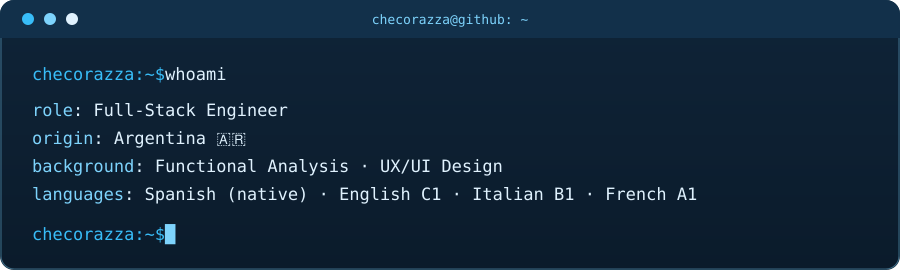

  <picture>
    <source media="(prefers-color-scheme: light)" srcset="./assets/whoami-light.svg">
    
  </picture>
  <picture>
    <source media="(prefers-color-scheme: light)" srcset="./assets/visual-map-light.svg">
    
  </picture>

<picture>
  <source media="(prefers-color-scheme: light)" srcset="https://img.shields.io/badge/C1-BAE6FD?&label=English&labelColor=0369A1&style=for-the-badge">
  
</picture>
<picture>
  <source media="(prefers-color-scheme: light)" srcset="https://img.shields.io/badge/Native-BAE6FD?&label=Spanish&labelColor=0369A1&style=for-the-badge">
  
</picture>
<picture>
  <source media="(prefers-color-scheme: light)" srcset="https://img.shields.io/badge/B1-BAE6FD?&label=Italian&labelColor=0369A1&style=for-the-badge">
  
</picture>
<picture>
  <source media="(prefers-color-scheme: light)" srcset="https://img.shields.io/badge/A1-BAE6FD?&label=French&labelColor=0369A1&style=for-the-badge">
  
</picture>

  <ul style="list-style: none">
    

      <h2>Skills</h2>
    

    ━━━━━━━━ ☆ ★ ☆ ━━━━━━━━
  </ul>

<a href="https://git.io/streak-stats"><picture><source media="(prefers-color-scheme: light)" srcset="https://github-readme-streak-stats-eight.vercel.app/?user=checorazza&theme=react&hide_border=true&background=E0F2FE&ring=0284C7&fire=0EA5E9&currStreakNum=0B2A43&sideNums=0B2A43&currStreakLabel=0369A1&sideLabels=0369A1&dates=0369A1"></picture></a>

  <ul style="list-style: none">
    

      <h2>Let's Connect!</h2>
    

    ━━━━━━━━ ☆ ★ ☆ ━━━━━━━━
  </ul>

Made in Argentina with lots of love and coffee. 

<a href="https://github.com/checorazza"><picture><source media="(prefers-color-scheme: light)" srcset="https://hits.sh/github.com/checorazza.svg?style=for-the-badge&label=Profile+views&color=BAE6FD&labelColor=0369A1"></picture></a>
<a href="https://github.com/checorazza?tab=followers"><picture><source media="(prefers-color-scheme: light)" srcset="https://img.shields.io/github/followers/checorazza?label=Followers&style=for-the-badge&color=BAE6FD&labelColor=0369A1"></picture></a>

